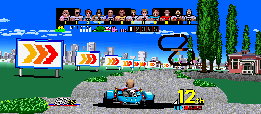
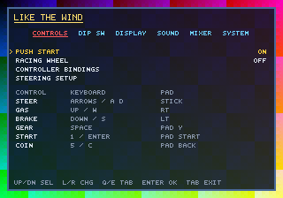

# LikeTheWind

**Version 1.1**

[**Download the latest version here**](https://github.com/hojoworks/likethewind/releases/latest)



LikeTheWind is a native PC port of **Power Drift** (Sega, 1988) using static
recompilation. It runs the original arcade game code through a hand-written 
Sega Y Board runtime. You supply your own `pdrift.zip`; the port verifies and
prepares it for you.

## Power Drift, unleashed

**The 1988 arcade classic is back! Sharper, louder, and wider than ever!**

### More screen. More speed. More Fun.

Play in crisp **4:3** or tear across **16:9**, **18:9**, **19:9**, **20:9** and full **21:9**
ultrawide! More road, more rivals, and more of the race in view.

### Turn it up loud, dude!

The arcade soundtrack has been lovingly remastered by hand  by a professional 
audio engineer and rebuilt for modern speakers. Switch between the original 
arcade mix and the remastered version. Hear this amazing arcade soundtrack like
never before!

### Steering that finally feels right.

Power Drift feels great straight out of the box. The default setup is tuned for
the keyboard, and plugging in a joystick or gamepad feels just as good with no
setup required. Want to fine-tune it? Advanced steering controls are there when
you need them.

### Lost voices from the arcade, restored for the first time!

Emily and Lucy finally have their original, unused voices restored! But that's
not all: previously hidden voice lines have also been uncovered for the other
drivers, including passing and collision reactions. Now every overtake and
scrape brings a little more personality to the race!

### The grand tour you were never meant to see.

One driver. Five championships. Two legendary bonus stages. **Special Tour**
strings the entire Power Drift world together into a single run, then sends you
through the secret **Afterburner** and **Hang-On** stages.

## How to run it

You need:

- Windows 10/11 x64, or x86_64 Linux with **glibc 2.34+**
- X11 or Wayland on Linux
- Your own MAME **`pdrift.zip`** World, Rev A

### Linux AppImage (recommended)

1. Download **`LikeTheWind-1.1-x86_64.AppImage`**.
2. Make it executable and run it:

```bash
chmod +x LikeTheWind-1.1-x86_64.AppImage
./LikeTheWind-1.1-x86_64.AppImage
```

3. Put **`pdrift.zip`** in the **`roms`** folder created beside the AppImage.

The AppImage includes SDL2 and the Linux audio runtime libraries. If the
AppImage is in a read-only location, its data goes to
`~/.local/share/likethewind` instead.

### Windows zip

1. Unzip the LikeTheWind release.
2. Put **`pdrift.zip`** in the **`roms`** folder beside `LikeTheWind.exe`.
3. Run `LikeTheWind.exe`.

The first launch verifies the ROM and creates `roms\.prepared\`; later launches
reuse that cache. The release is portable and needs no installer.

## Default controls

| Action | Keyboard | Gamepad/joystick |
| --- | --- | --- |
| Steer | Arrow keys / A, D | Left stick or D-pad |
| Accelerate | Up / W | RT or A |
| Brake | Down / S | LT or B |
| Gear | Space | Y |
| Start | 1 / Return | Start |
| Coin | 5 / C | Back |
| Service / Test | F1 / F2 | N/A |
| Settings menu | Tab | LB + RB |
| Quit | Esc | N/A |



## Menu basics

Press **Tab** to open the menu. Use Up/Down to select, Left/Right to change a
value, Q/E for the previous/next page, Enter to confirm, and Backspace to go
back. **Run in Background** is on by default; turn it off in System to pause
the game and audio behind the menu.

Use **Controls > Controller Bindings** to remap buttons and axes. **Steering
Setup** contains the steering/pedal dead zones, digital and analog steering
rates, centre rate and rebound. **Racing Wheel** uses the selected wheel axis
directly. Enable **Automatic Gearbox** to shift into high gear at 160 km/h and
back down below it.


## Video

LikeTheWind supports **4:3, 16:9, 18:9, 19:9, 20:9 and 21:9** aspect ratios,
with **60, 120 and 144 FPS** modes. New installs default to **16:9 @ 60 FPS**.
60 FPS presents one new board frame per refresh (60 presents/sec); 120 and 144
add cross-faded in-between frames, capped by the display refresh rate.

### Audio

The Sound page controls the music, effects, engine and master levels. The
Mixer page has individual channel levels, chorus and plate reverb. Use **Audio
Mix** to switch between the flat **Stock** mix and the per-song **Hojo's Mix**.

#### Hidden voices from the arcade, finally restored for the first time!

The original arcade release had more to say, and now you can hear it.

- **RESTORE EMILY / LUCY VOICES** - Emily and Lucy get their original female
  driver lines back for the first time ever!
- **ADDITIONAL RESTORED VOICES** - Hear even more attitude and unluck additional
voice lines for all characters never heard before!


### The full Power Drift grand tour.

Flip on **SPECIAL TOUR MODE** in System and the arcade’s one-course credit
becomes a proper championship! Battle through all 25 courses plus the 
hidden Afterburner and HangOn stages! Record your total tour score for
bragging rights and prove you are the Power Drift master!

## Supported ROM

LikeTheWind supports the **`pdrift.zip`** set (World, Rev A) only. The
`pdrifta`, `pdrifte`, Japanese and link versions are not compatible. The game
verifies all 48 required source files by size, CRC-32 and SHA-1.

## How it works

A lot of projects called “recompilations” are really emulators with extra steps:
the game is decoded instruction by instruction every frame, or only a few hot
functions are translated while everything else stays interpreted. Others rewrite
the game by hand.

LikeTheWind actually converts the game. During the build, the original 68000
routines are translated into C and compiled into the PC executable. At runtime
those native routines are the game. The PC side provides the arcade hardware
around them: memory, video, sound and input. The original game code, registers,
stack, interrupts and timing stay in charge.

If the translator hits a computed jump or an address it could not see at build
time, the fallback interpreter catches it and reports the address. That path is
added to the next build and translated. Missing code is treated as a bug to fix,
not hidden behind an emulator.

## Troubleshooting

- If the ROM is rejected, make sure it is `pdrift` World Rev A, not `pdrifta`.
- If the Linux window stays offscreen or missing, check that
  `libSDL2-2.0.so.0` is beside the executable, then run
  `ldd ./LikeTheWind-linux | grep "not found"` to check for missing libraries.
- Special Tour always continues from the final course into the Afterburner and 
Hang-On bonus stages, regardless of placement.
- Crash reports are written as `crash.log` beside the executable.

## Build it yourself

The build host is Windows 10/11 x64 with Python 3.10+.

```powershell
powershell -ExecutionPolicy Bypass -File tools\build.ps1
```

Use `-EntriesOnly` to seed the recompiler from the checked-in analysis entries
and coverage data:

```powershell
powershell -ExecutionPolicy Bypass -File tools\build.ps1 -EntriesOnly
```

Build the portable Linux release:

```powershell
powershell -ExecutionPolicy Bypass -File tools\build_linux.ps1
```

Build both releases into `dist\`:

```powershell
powershell -ExecutionPolicy Bypass -File tools\build.ps1 -Package -EntriesOnly
```

For a development run:

```powershell
python tools\prepare_rom.py roms\pdrift.zip --out work\roms
build\LikeTheWind.exe --rom work\roms --play
```

To record sound commands and game state while playing:

```powershell
build\LikeTheWind.exe --rom work\roms --play --sound-log work\play-sound.csv
```

During play, press `F5` for a passing line, `F6` for a wall hit, `F7` for
an enemy hit and `F8` for an announcer line. Each key writes a marker row to
the CSV; every queued sound command is logged with the current frame, mode,
selected character, speed and input state.

For a passive recording that needs no key presses, log the actual PCM sample
starts instead:

```powershell
build\LikeTheWind.exe --rom work\roms --play --sample-log work\play-samples.csv
```

This writes one row per sample lane start with the sample ID in hex, source
voice, mixer group and the same game-state fields.

## Legal

No ROMs, generated code from ROMs, or playable game data are distributed here.
You need to own the arcade board or otherwise be authorised to use its ROM
data. Power Drift and Sega are trademarks of their respective owners; this is
an unofficial fan preservation project.

The project's own code is MIT. Third-party licences are listed in
[`THIRD_PARTY_NOTICES.md`](THIRD_PARTY_NOTICES.md).
